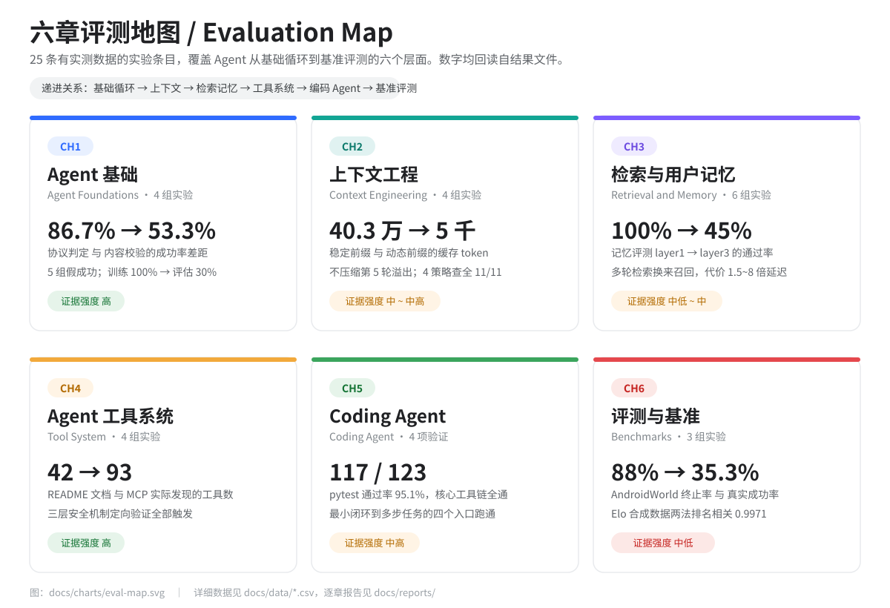
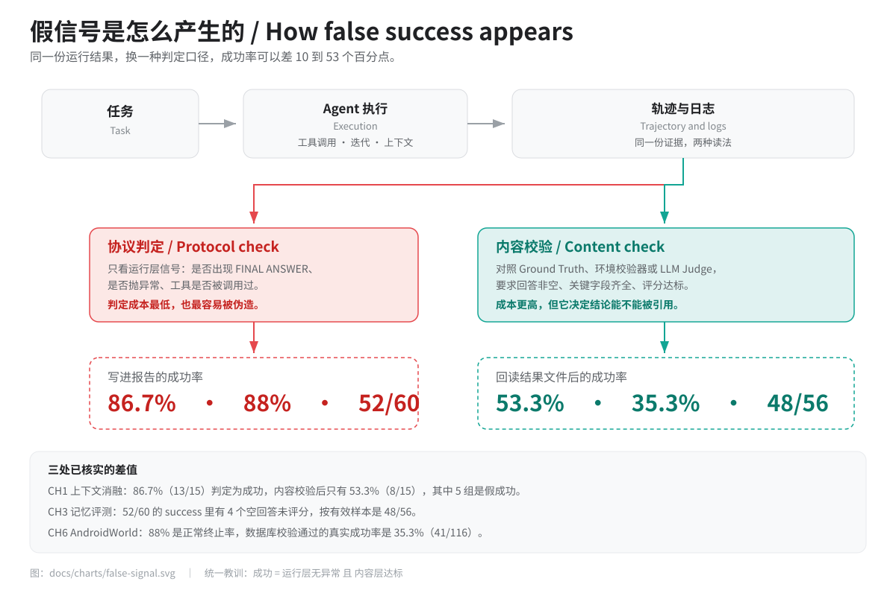
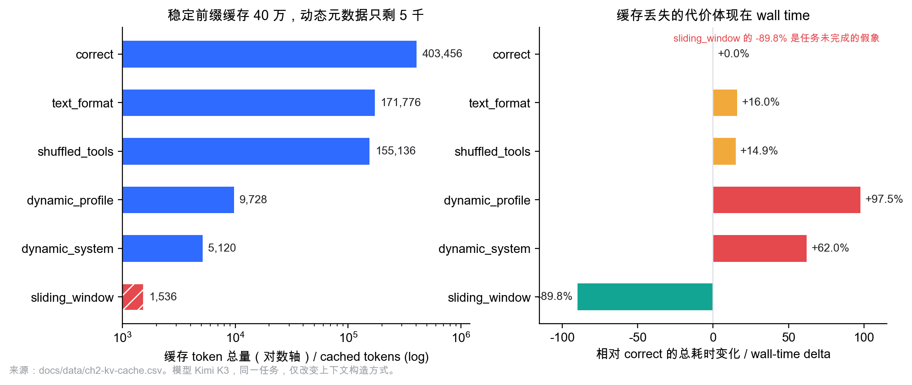
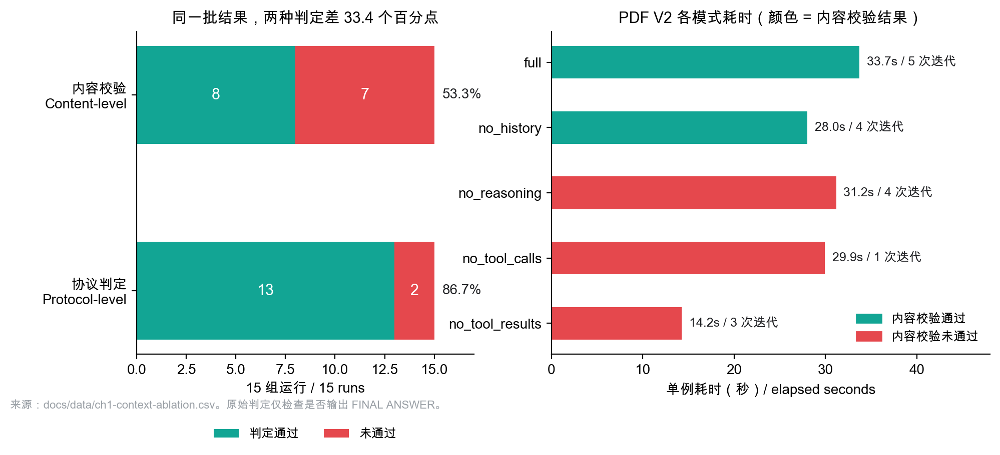
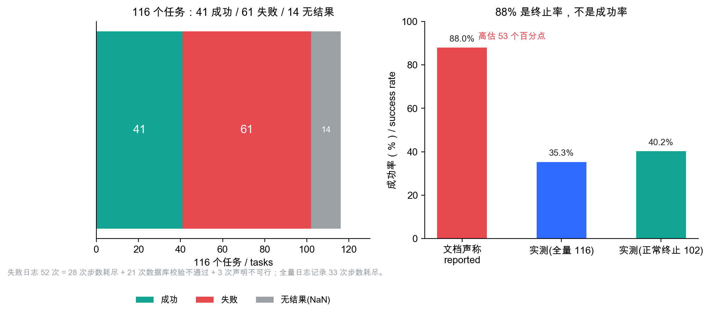

# Agent 评测实验档案 / Agent Evaluation Experiments

六章实验、25 条有实测数据的条目。能回读的数字都核对过结果文件；回读不了的，在报告里明确标成"中低"或"低"。这个目录把散落在六份报告里的数字、图表和踩坑记录，整理成一份可以直接阅读、也可以直接复算的公开档案。

*Six chapters, 25 measured experiment entries. Numbers were checked against result files or logs wherever those exist; where they do not, the report says so and lowers the evidence rating. This folder turns six internal reports into a readable, checkable public archive.*

---

## 这个目录是什么 / What this is

这不是一份"Agent 很强"的宣传材料。它记录的是 **一次从零搭建 Agent 课程实验的过程**：哪些指标真的可信、哪些成功是被判定协议伪造出来的、哪些优化在换一个任务后反而变差、哪些问题根本不是算法问题而是环境问题。

*This is not a "look how good our agent is" showcase. It documents what happened when six chapters of agent experiments were actually run: which metrics held up, which successes were artifacts of the scoring protocol, which optimizations backfired on a different task, and which blockers were infrastructure rather than modelling.*

- 覆盖范围：Agent 基础循环、上下文工程、检索与用户记忆、工具系统、Coding Agent、评测基准。
- 技术栈：Python / Docker / MCP / FastAPI / pytest，模型来自百炼 DashScope、Kimi、OpenAI 兼容端点。
- 阅读顺序：先看下面的五条结论，再按章节进入报告；每条结论后面都能找到对应的图和 CSV。

---

## 五条最值得看的结论 / Five findings worth your time

**1. "成功"是最容易伪造的指标。** 同一批 15 组运行，只检查输出里有没有 `FINAL ANSWER`，成功率是 86.7%；加上内容校验后是 53.3%，中间 5 次是假成功。AndroidWorld 的 88% 也不是成功率，而是"正常终止率"，数据库校验后只剩 35.3%。

**2. 完成率不等于正确率。** 记忆评测里 60 个用例的 success 有 52 个，但其中 4 个回答长度是 0、根本没有评分；按有效样本算是 48/56。指标好看，任务没做完。

**3. 上下文稳定性直接等于钱。** 同一个任务、同一个模型，稳定前缀能缓存 40.3 万 token；每轮插入变化的用户积分后只剩 9,728，总耗时 +97.5%；每轮加时间戳只剩 5,120，耗时 +62.0%。

**4. 每个优化都有反向代价。** 多轮检索把关键词召回从 36.67% 拉到 83.33%，但耗时变成 8.12 倍；系统提示让复杂任务收益明显，却让一个线性任务从 7 轮完成退化到 30 轮空转；窗口压缩最快，却丢掉了任务结果。

**5. 真正先卡住实验的，多数不是模型。** 推理模型的 temperature 限制、Kimi 平台 `$web_search` 第二轮固定 400、MCP 1.x/2.x 的 `FastMCP` 改名、Docker 在 arm64 上跑 amd64 二进制、仓库里一个缺失的 `List` 导入——这些基础设施问题出现的频率，远高于算法层面的发现。

---

## 六章速览 / Six chapters at a glance

| 章节 | 实验数 | 核心命题 | 最关键的数字 | 证据强度 |
|---|---|---|---|---|
| [第 1 章 Agent 基础](reports/chapter1实验总结报告.md) | 4 | 消融与范式对比是否成立 | 86.7% 判定 → 53.3% 真实；LLM 评估 30% vs RL 0% | 高 |
| [第 2 章 上下文工程](reports/chapter2实验总结报告.md) | 4 | 上下文结构与压缩策略如何影响成本 | 缓存 40.3 万 vs 5,120 token；耗时 +97.5% | 中 ~ 中高 |
| [第 3 章 检索与记忆](reports/chapter3实验总结报告.md) | 6 | 多轮检索与双层记忆的真实收益 | 召回 +46.67 pp、耗时 8.12 倍；记忆 48/8/4 | 中低 ~ 中 |
| [第 4 章 工具系统](reports/chapter4实验总结报告.md) | 4 | MCP 工具层能否端到端跑通 | 实测 93 个工具（文档 42）；三层安全机制全触发 | 高 |
| [第 5 章 Coding Agent](reports/chapter5实验总结报告.md) | 4 | 纯 Python Coding Agent 的完整闭环 | pytest 123 收集 / 117 通过 / 6 失败 | 中高 |
| [第 6 章 评测与基准](reports/chapter6实验总结报告.md) | 3 | 基准分数与排行榜方法是否可信 | 成功率 88% → 35.3%；Elo 排名相关 0.9971 | 中低 |

<p align="center">
  
</p>

完整的逐章命题、样本量、结论与局限，见各章报告；本页只做索引和交叉引用。

---

## 六章在讲什么 / Chapter briefs

### 第 1 章 · Agent 基础 / Agent Foundations

四个子实验：`context` 做五种上下文消融 × 三套任务；`learning-from-experience` 对比 LLM 上下文学习与 Q-Learning；`search-codegen` 验证百炼 Responses API 与 qwen3.7-plus 的工具对齐；`web-search-agent` 记录 Kimi 内置搜索从连续失败到换模型跑通的过程。

最关键的发现是判定协议：15 组运行里，协议层判 13 组成功（86.7%），内容校验只认 8 组（53.3%）。另有一个干净的范式对照：Q-Learning 训练 5,000 局、耗时 2.39 秒、训练胜率 0.02%；GLM-5 只训练 20 局、耗时 1 小时 56 分、训练胜率 100%，但评估胜率只有 30%。样本效率差 250 倍，评估差距只有 30 个百分点，方向并不一致。

### 第 2 章 · 上下文工程 / Context Engineering

`kv-cache` 用 6 种上下文构造方式测缓存与耗时；`context-compression` 用 6 种压缩策略跑同一个 11 人查证任务；`prompt-engineering` 试图复现"提示质量下降导致 30~80% 性能损失"，但样本只有单任务、无基线，结论不成立；`system-hint` 验证 TODO、调用计数、错误详情等提示的收益。

缓存数字很直接：稳定前缀 403,456 token，历史转纯文本降到 171,776，工具顺序打乱 155,136，每轮变化的用户积分只剩 9,728，每轮变化的 system prompt 只剩 5,120。压缩方面，不压缩在第 5 轮就溢出；context-aware 摘要零溢出、累计 11.6 万 token；窗口压缩最快（1,171 秒），但仍溢出 2 次，累计 token 反而涨到 16.6 万。

### 第 3 章 · 检索与记忆 / Retrieval and Memory

六个子实验围绕"多轮检索值不值"和"用户记忆能不能用"。`agentic-rag` 的关键词召回 83.33% 对 36.67%，但平均耗时 271.23 秒对 33.39 秒；`contextual-retrieval` 两种模式的召回都是 90.48%，没有质量增益；`contextual-retrieval-for-user-memory` 用 60 例跑三层难度，实得 48 通过、8 失败、4 未评分；`user-memory` 的 97 个单测全过，但修复水位线 bug 前，端到端记忆实际是失效的。

这章最值钱的不是"Agentic RAG 更好"，而是三处指标失真：复杂题回答为空却记 success、报告写 52/60 但结果文件是 48 通过、索引 1,397 条而三个服务实际加载 1,381 / 1,456 / 1,381 条。

### 第 4 章 · 工具系统 / Tool System

按"感知 → 执行 → 协作 → 编排"渐进集成四个子项目，全程 Docker。感知 50 个工具零外部 Key 可跑；执行 6 个工具的三层安全机制（语法拦截、LLM 审批、输出压缩）定向验证全部触发；协作 37 个工具的逻辑层全过；事件编排 Agent 一次 `POST /event` 就能发现并调用工具完成 `ls`。

README 写 42 个工具，实际 `list_tools()` 返回 93 个（37 + 6 + 50）。过程中记录 10 余项阻塞与修复，包括 MCP 版本改名、Dockerfile 三处构建硬伤、pandas 3.x 与 scikit-learn 不兼容，以及仓库原有的 `List` 缺失导入。

### 第 5 章 · Coding Agent

纯 Python 实现的 Coding Agent，四个入口渐进验证：`quickstart.py` 最小闭环、`example_with_system_hints.py` 系统提示注入、`example_complex_task.py` 多步任务拆解、`pytest tests/` 单元测试。

只改了 2 个文件（`config.py` 增加 dashscope provider、`agent.py` 增加一条 OpenAI SDK 路径）就接入了 DashScope。pytest 收集 123 个用例，117 通过、6 失败，通过率 95.1%；6 个失败集中在后台输出时序、错误消息措辞、超时捕获、Grep 无效正则的返回语义、集成元数据和二进制检测，核心工具链全部通过。

### 第 6 章 · 评测与基准 / Benchmarks

`AndroidWorld` 基线用 Claude 4 Sonnet 跑 116 个跨应用任务，汇总表 41 成功、61 失败、14 无结果，真实成功率 35.3%，排除无结果后 40.2%；文档里的 88% 是正常终止率。`android-world` 本地复现用 qwen3.8-flash + Mock 设备，同一 Timer 任务 7 步完成，原版同任务 10 步失败，但只有 1 条轨迹。`elo-leaderboard` 用 5,000 条合成对战比较 Bradley-Terry MLE 与 Online Elo，排名相关 0.9971，Top-1 评分 1,257.4（95% CI [1,235.5, 1,280.0]）。

---

## 关键图表 / Key charts

同一份轨迹，两种判定方式，结果差 10 到 53 个百分点。这张图把整份档案的主线画出来了：

<p align="center">
  
</p>

上下文稳定性的代价，可以用缓存 token 和 wall time 直接量化：

<p align="center">
  
</p>

<p align="center">
  
</p>

<p align="center">
  
</p>

其余图表：

| 图 | 说明 | 对应章节 | 数据 |
|---|---|---|---|
| [ch1-llm-vs-rl.png](charts/ch1-llm-vs-rl.png) | LLM 上下文学习与 Q-Learning 的胜率、奖励对比 | 1 | [CSV](data/ch1-llm-vs-rl.csv) |
| [ch2-context-compression.png](charts/ch2-context-compression.png) | 6 种压缩策略的 token、耗时与溢出次数 | 2 | [CSV](data/ch2-context-compression.csv) |
| [ch3-difficulty-gradient.png](charts/ch3-difficulty-gradient.png) | 60 例记忆评测的通过率、reward、耗时梯度 | 3 | [CSV](data/ch3-memory-60cases.csv) |
| [ch4-tool-inventory.png](charts/ch4-tool-inventory.png) | 文档 42 个工具与实测 93 个的构成差异 | 4 | [CSV](data/ch4-tool-inventory.csv) |
| [ch5-pytest.png](charts/ch5-pytest.png) | pytest 通过率与 6 个失败用例的归因 | 5 | [CSV](data/ch5-pytest.csv) |
| [ch6-elo.png](charts/ch6-elo.png) | Top-1 与 Top-10 模型的 BT 评分与置信区间 | 6 | [CSV](data/ch6-elo.csv) |

---

## 跨章结论 / Cross-chapter findings

1. **假成功有固定套路。** 运行层只看"有没有报错、有没有输出 FINAL ANSWER"，内容层才看"答案对不对"。第 1、3、6 章在三套完全不同的任务上，都复现了同一个偏差。
2. **复杂任务上，多步检索买到的召回远贵于它省下的错误。** 第 3 章召回提升 46.67 个百分点，时间变成 8.12 倍；第 2 章最快的窗口压缩是 1,171 秒，但仍溢出 2 次、token 总量 16.6 万。速度、token 和正确率在这批实验里很少同时最优。
3. **上下文一旦不稳定，缓存收益立刻归零。** 第 2 章把"每轮改一点东西"的代价量化成了 78 倍的缓存差距和接近翻倍的耗时。
4. **基础设施故障的出现频率高于算法发现。** temperature 限制、平台 400、MCP 版本、arm64 镜像、缺失导入，这些在第 1、4、5 章反复出现。真实部署里先解决这些，才轮到调参。
5. **样本量不对称时，结论只能当方向。** 第 1 章 LLM 评估 10 局对 RL 100 局；第 6 章本地复现只有 1 条轨迹。报告里都标了"中低"或"中"，引用时需要保留这个限定。
6. **单测全过不代表系统可用。** 第 3 章 97/97 单测通过，但修复水位线 bug 前，记忆系统在端到端场景里实际失效；第 5 章 117/123 通过，6 个失败都落在边界，不影响主链路，但也不该被写成"全过"。

---

## 怎么读这些报告 / How to read the reports

六份报告是同一套骨架，便于横向对照：

1. **总览**：一张表给出每个子实验的命题、模型/规模、样本量、实测结论、证据强度。
2. **每个实验四段**：设计（怎么跑、控制什么变量）、实测数据（原始数字与表格）、结论、局限与问题。
3. **跨实验结论**：把本章重复出现的现象抽出来，通常带反例。
4. **方法学与复现性问题处置清单**：哪些数字回读后改了、为什么改。
5. **待补测项**：明确列出没做完、不能下结论的部分。
6. **证据索引**：指向结果文件、日志、轨迹的路径。

本档案使用的证据强度约定（阅读辅助，不是论文评级）：

| 等级 | 含义 |
|---|---|
| 高 | 有完整结果文件或逐例记录，有对照组，统计口径明确，可二次核算 |
| 中高 | 有结果文件或完整日志，至少一个关键维度可复核 |
| 中 | 数据主要来自报告文本或终端输出，可核对但无法完整复算 |
| 中低 | 单次运行、无对照，或已确认指标口径失真 |
| 低 | 样本 n=1 且无基线，或运行框架本身崩溃 |

另外三条阅读提醒：

- **报告里的 `chapterN/...` 路径**指向原始课程仓库，不在本目录内。本目录是总结报告的归档副本，不包含源码、原始日志和大体积结果文件。
- **"样本量"列写的是实际运行次数**，不是计划次数。看到 7 次运行、1 条轨迹、10 局评估，就应该按这个量级理解置信区间。
- **被排除的子项目也写进了排除说明**，理由通常是"只有 README、没有结果文件"。排除不是否定，只是不把它当证据。

---

## 数据与图表 / Data and charts

`data/` 里是报告中关键表格的机读版本，只保留能回读到结果文件的字段，不补全、不推算。

| 文件 | 内容 | 来源章节 |
|---|---|---|
| [ch1-context-ablation.csv](data/ch1-context-ablation.csv) | 五种消融模式的协议判定、内容校验、耗时、迭代数 | 1 |
| [ch1-llm-vs-rl.csv](data/ch1-llm-vs-rl.csv) | LLM 与 Q-Learning 的训练/评估指标对照 | 1 |
| [ch2-kv-cache.csv](data/ch2-kv-cache.csv) | 六种上下文模式的缓存 token、耗时、变化比例 | 2 |
| [ch2-context-compression.csv](data/ch2-context-compression.csv) | 六种压缩策略的完成状态、溢出、token、耗时 | 2 |
| [ch3-agentic-rag.csv](data/ch3-agentic-rag.csv) | Agentic 与非 Agentic 的召回、耗时、回答长度 | 3 |
| [ch3-memory-60cases.csv](data/ch3-memory-60cases.csv) | 三层记忆评测的通过、评分、检索块数、耗时 | 3 |
| [ch4-tool-inventory.csv](data/ch4-tool-inventory.csv) | 三个 MCP 服务器的工具数与总计 | 4 |
| [ch5-pytest.csv](data/ch5-pytest.csv) | pytest 收集、通过、失败数量 | 5 |
| [ch5-pytest-failures.csv](data/ch5-pytest-failures.csv) | 6 个失败用例与根因 | 5 |
| [ch6-androidworld-outcomes.csv](data/ch6-androidworld-outcomes.csv) | 116 个任务的成功、失败、无结果构成 | 6 |
| [ch6-androidworld-failures.csv](data/ch6-androidworld-failures.csv) | 失败日志的 52 次失败归因 | 6 |
| [ch6-elo.csv](data/ch6-elo.csv) | Top-1 / Top-10 模型的 BT 评分与置信区间 | 6 |

图表由 [generate_charts.py](charts/generate_charts.py) 从这些 CSV 生成，不手工填数：

```bash
cd charts
python3 generate_charts.py
```

依赖只有 `matplotlib`。图表标题和正文按中文排版，因此脚本使用 `Arial Unicode MS` 字体；缺少该字体时，把 `rcParams["font.family"]` 换成系统里的中文字体即可。

数据取舍有三条规则：**只放回读过的数字；不把报告结论当数据；原始日志和二进制产物不进仓库**。因此这些 CSV 能复现图，但不能替代证据索引。

---

## 目录结构 / Repository layout

```
docs/
├── README.md                    本页：索引、结论、阅读约定
├── reports/                     六份逐章总结报告（归档副本）
│   ├── chapter1实验总结报告.md
│   ├── chapter2实验总结报告.md
│   ├── chapter3实验总结报告.md
│   ├── chapter4实验总结报告.md
│   ├── chapter5实验总结报告.md
│   └── chapter6实验总结报告.md
├── charts/                      图表与生成脚本
│   ├── eval-map.svg             六章评测地图
│   ├── false-signal.svg         假成功信号的产生路径
│   ├── ch1-*.png ... ch6-*.png  九张数据图
│   └── generate_charts.py       CSV → PNG
└── data/                        十二份关键数据摘要（CSV）
```

---

## 运行环境 / Environment

- macOS（Apple Silicon），实验主体在 Docker `python:3.12-slim`（arm64）容器内完成，宿主机端口 `8020→8000`。
- 模型：deepseek-v3 / v4-flash、GLM-5、qwen3.7-plus / qwen3.8-flash / qwen3.8-max、Kimi K3 / K2.6、Claude 4 Sonnet、GPT-5（OpenRouter）。
- 工具链：MCP、FastAPI、pytest、matplotlib。

---

## 引用与说明 / Notes

- 报告中的模型名、价格、接口行为记录于 2026 年 11 月，平台策略可能已经变化。
- 所有数字以本目录 `data/` 与报告内的"实测数据"小节为准；若与他人转述冲突，以结果文件回读值为准。
- 欢迎指出数字与结果文件不符的地方，这类问题在本档案里优先级最高。
